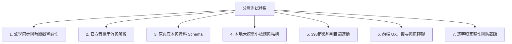

# 🧪 自動化測試套件規範與要求說明 (Testing Specification)

本專案建立了涵蓋 **單元測試（Unit）**、**驗收測試（Acceptance）**、**端到端瀏覽器測試（Browser Smoke）** 與 **聲學盲測（Acoustic Verification）** 的全方位自動化測試體系。測試數量與結果以該版本的 CI 報告為準，不將歷史通過數視為當前驗收。

---

## 📋 測試類別與涵蓋要求



---

### 1️⃣ 聲學同步與時間戳嚴謹性測試 (Acoustic & Monotonicity)
* **相關檔案**：`tests/unit/timeAligner.test.js`, `tests/unit/syncPlayer.test.js`, `tests/unit/textSegmenter.test.js`, `tests/acceptance/localModelHeadings.test.js`, `scripts/verify_audio_sync.py`
* **檢驗要求**：
  1. **時間戳嚴格單調遞增**：所有句子必須滿足 $s[i].\text{start} \ge s[i-1].\text{end} - 0.05$ 秒，絕不允許時間軸回溯或倒流。
  2. **二分搜尋效率**：`findSentenceIndexByTime` 需在 $O(\log N)$ 時間複雜度內精確鎖定當前發音句子。
  3. **語音停頓平滑維持**：法師開示停頓（Silence gap）期間，播放器需平滑維持上一句的高亮狀態，不閃爍。
  4. **比例縮放適應（Ratio Scaling）**：當音訊時長與逐字稿有些微時差時，自動計算比例對齊。
  5. **聲學盲測吻合度**：`verify_audio_sync.py` 透過 FFmpeg 隨機截取 15 段音訊並呼叫 ASR 交叉比對，吻合率需 $\ge 75\%$。

---

### 2️⃣ 官方原始音檔解析測試 (Audio Map & Stream Resolution)
* **相關檔案**：`tests/unit/audioMap.test.js`, `tests/unit/resolveAudioUrl.test.js`
* **檢驗要求**：
  1. **198 講全量覆蓋**：`audio_map.json` 必須 100% 包含全書 198 堂課的官方 Flyday 原始 MP3 串流網址。
  2. **解析相容性**：`resolveAudioUrl` 需同時支援相對路徑（`audio/29A.mp3`）與官方遠端 URL（`https://buddha.flyday.com.tw/...`）。
  3. **播放保護**：防止未緩衝的音訊直接 seek 導致播放器卡死或重頭播放。

---

### 3️⃣ 《入中論善顯密意疏》原典底本對齊測試 (Treatise Ground Truth)
* **相關檔案**：`tests/unit/sourceTextGrounding.test.js`, `tests/unit/dataSchema.test.js`
* **檢驗要求**：
  1. **285 頁原典底本存在性**：驗證真值底本（Ground-truth）285 頁論著全文皆存在且內容完整。
  2. **月稱菩薩本頌驗證**：驗證 `all_verses.json` 中收錄的所有偈頌出處與頁碼對照無誤。
  3. **講次頁碼映射**：驗證 `course.json` 中各堂課標註的 `pageRange` 皆能精確對應到真實論著頁面。
  4. **Schema 嚴格性**：驗證所有 `session_*.json` 符合 `sessionId`, `audioUrl`, `lastUpdated`, `paragraphs`, `sentences` 標準格式。

---

### 4️⃣ 本地大模型篇章結構與小標題測試 (Local LLM Structure & Headings)
* **相關檔案**：`tests/acceptance/localModelHeadings.test.js`
* **檢驗要求**：
  1. **主題劃分合理性**：驗證大模型產出 6～10 個符合《善顯密意疏》論義轉折的章節小標題。
  2. **DOM 視覺渲染**：驗證包含標題的段落能正確在網頁中生成 `<h3 class="transcript-heading">`。
  3. **段落 ID 綁定**：小標題需精準綁定至對應的起始段落 ID（如 `p-1`, `p-27` 等）。

---

### 5️⃣ 🌟 29A 黃金標準高階驗收測試 (29A Golden Benchmark Quality Standard)
* **相關檔案**：`tests/acceptance/goldenStandard.test.js`
* **檢驗要求（針對所有已完成轉換之最新講次）**：
  1. **Pattern 1 - 引擎與版本元數據**：驗證包含 `_meta.engine` (Whisper Large-v3)、`_meta.llm_proofread` (Qwen3.8-27B)、`lastUpdated` (YYYY-MM-DD) 以及段落/句子計數完全一致。
  2. **Pattern 2 - 官方廣播級音訊串流**：驗證 `audioUrl` 直連 Flyday 官方原始 MP3 串流。
  3. **Pattern 3 - 主題小標題格式與段落密度**：驗證小標題語法為 `【主題】說明`，且平均段落密度介於 1.5～8.0 句之間。
  4. **Pattern 4 - 禁用同音字與法相純淨度（Negative Patterns）**：硬性斷言絕無「非紋症/肺紋症」、「至向有/自向有」、「損壞羹/更」、「設法心法」、「不先一心法」、「生一地/生意地」、「七狂法/七況法」、「羊眼」等 ASR 語音錯字。
  5. **Pattern 5 - 毫秒級聲學嚴格單調性**：驗證每個句子時間戳 $s[i].\text{start} \ge s[i-1].\text{end} - 0.05$ 秒，完全消除時間軸回溯。

---

### 6️⃣ 全書總科判目錄體系連動測試 (TOC & Navigation)
* **相關檔案**：`tests/unit/toc.test.js`, `tests/cross-artifact-consistency.test.js`
* **檢驗要求**：
  1. **393 個階層節點**：驗證 17 頁完整總科判（甲、乙、丙、丁、戊、己、庚層級）完整載入。
  2. **講次跳轉連動**：點擊科判條目必須正確跳轉至該講次與課本頁碼，絕無死連結（Dead links）。

---

### 6️⃣ 前端 UX、搜尋與無障礙測試 (Search, UX & A11y)
* **相關檔案**：`tests/unit/search.test.js`, `tests/unit/sidebarFilterBehavior.test.js`, `tests/unit/uxCourseOverview.test.js`, `tests/unit/a11y.test.js`, `tests/acceptance/browserSmoke.test.js`
* **檢驗要求**：
  1. **即時文字搜尋**：支援逐字稿內全文搜尋、黃色高亮匹配、`Enter` / `Shift+Enter` 上下跳轉匹配點、`Escape` 清除。
  2. **側邊欄多維過濾**：支援依講次編號（`02A`）、摘要關鍵字（`歸敬頌`）、頁碼（`p.63`）進行模糊過濾。
  3. **無障礙（A11y）防 Tab 陷阱**：實作 Roving Tabindex（僅第一句為 Tab focusable，其餘為 `-1`），防止鍵盤使用者陷入千句 Tab 迴圈。
  4. **瀏覽器端到端正常性**：Console 零致命報錯、所有 JS/CSS/JSON/MP3 資源 Content-Type 正確無誤。

---

### 7️⃣ 逐字稿完整性與防截斷測試 (Completion & Quality)
* **相關檔案**：`tests/acceptance/completion.test.js`, `tests/quality.test.js`, `tests/required-set-not-truncated.test.js`
* **檢驗要求**：
  1. **零內容遺漏**：逐字稿字數需與音訊時長完全匹配，無任何開頭或結尾截斷。
  2. **零大模型殘留雜質**：文字中絕不可包含「好的，這是我為您校對的...」或 Markdown 代碼塊等 Prompt 雜訊。

---

## 🏃 執行全套測試

```bash
npm test
```
* **期望結果**：零失敗；逐項列出 skip 與適用範圍。歷史數量不作為當前通過依據。


## 閱讀器發布 Test Patterns（2026-10-24）

來源：第 30 講重整版曾只新增獨立出版頁，主閱讀器仍載入舊 session。產物正確與 CI 通過，不代表使用者原入口已更新。以下七層須分別驗證：

| Pattern | 驗證契約 | 執行入口 |
| --- | --- | --- |
| 入口整合 | 從實際 course metadata 與原網址載入 App；本文套用已核定版本，不能只驗證連結存在 | `tests/unit_v2/shiliangRebuildReader.test.ts` |
| 資料保真 | ID、順序、時間、文字完整；source／approval digest 變動須拒絕投影；閱讀確認不冒稱聽核 | `tests/unit/shiliangRebuildReader.test.js` |
| 失敗回退 | 404、網路例外、過期來源及未核定內容：明示顯示原稿，保留末句與全句數，不顯示「本文已套用」或新版日期 | `tests/unit_v2/shiliangRebuildReader.test.ts` |
| 畫面／下載一致 | 實際點擊下載，核對全部句子與原時間碼、標題及未逐句聽核提醒；formatter 單元測試不能取代下載驗收 | `tests/browser/readerRelease.spec.ts` |
| 日期更新與追溯 | 主頁與實際下載的「重整版最後更新」須一致且等於本版核定日期；原日期另標「底稿校正日期」，不能以舊底稿日期冒充新版日期 | `tests/unit_v2/shiliangRebuildReader.test.ts`、`tests/browser/readerRelease.spec.ts` |
| 音訊校準與點擊播放 | 音源同一性、全句聲學邊界及未解決風險；拒絕僅單調遞增的假校準 | `tests/unit/audioCalibrationGate.test.js`；聲學證據另驗證 |
| 版本／部署驗收 | 在上傳前的相同 `_site` 及部署後原網址，以桌面／手機 Chromium 驗證預期 build 資產、已核定正文與標題、實際下載 | `.github/workflows/deploy.yml` |

日期 pattern 的判定：

- 新版主頁的主要更新日期及實際下載文檔，都必須取自該版 `readingApproval.approvedAt`；不可只驗證日期字串存在，也不可取測試當天日期自動充新。
- 底稿 `lastUpdated` 原樣保留，僅以「底稿校正日期」呈現；不修改來源日期讓測試通過。未套用重整版的講次沿用原日期語意。
- 若已套用新版卻仍以舊底稿日期顯示「最後校正更新／最後更新」，即使正文已更新，也判定 FAIL。主頁與下載日期不一致亦 FAIL。
- 來源／核定驗證失敗而回退原稿時，不得顯示新版已套用或新版日期。原本開著的分頁重新載入時，應取得最新 publication metadata，不沿用舊入口設定。
- 在 PR／main 的 App 測試及 Linux browser gate、部署前 artifact、部署後正式網址，均驗證此契約。目前涵蓋第 30、31 講的桌面／手機與真實下載；不是全庫日期校訂宣告。

瀏覽器 gate 不得因缺 Chromium 或網址不可達而 skip；載入舊資產、舊正文或缺少正文皆失敗。預期值來自 checkout 的 build 與已核定 publication，不能從待驗證網站反推預期值。部署成功後 smoke 失敗，整個部署 workflow 仍為失敗，須修復或 revert，不以 deploy-pages 成功冒稱驗收完成。

瀏覽器會從釋量論第二品 course metadata 自動列舉所有已發布且 sourceRebuildStatus 為 reading-approved 的講次，目前包含第 30、31 講；兩講主頁、核定正文與實際下載均須通過。已發布核定重整版若缺少主閱讀器啟用設定，Node 與 browser gate 都直接失敗，不能從案例清單靜默漏掉。此範圍仍不代表全庫均已驗證；新增其他課程或發布路徑時須增加案例。測試攔截外部 YouTube 媒體與 Google Fonts 字型請求以降低外部服務干擾；本站 JS／CSS／JSON 維持真實載入。這是閱讀器與下載工程 gate，不是影音播放、聲學對齊或人工聽核。

```bash
# 既有快測與失敗回退
npx vitest run tests/unit_v2/shiliangRebuildReader.test.ts
node --test tests/unit/shiliangRebuildReader.test.js

# 瀏覽器：須先 build 與準備站台，CI 自動執行以下兩階段
npx playwright install --with-deps chromium
READER_BASE_URL=http://127.0.0.1:4173/Transcriptions/ npm run test:reader-smoke
READER_SMOKE_PHASE=deployed READER_BASE_URL=https://huanruilee.github.io/Transcriptions/ npm run test:reader-smoke
```

前一個指令要求本機伺服器提供與預計上傳相同的站台，且 `dist/index.html` 是該版本 `vite build --base=/Transcriptions/` 的輸出。CI 的準備與啟動方式見 deploy workflow。每次瀏覽器驗收保存 JSON 結果與成功畫面；失敗另保存 screenshot／trace，附於該 deployment run 的 `reader-release-<SHA>` artifact。artifact 與 deployed 結果分開保存。測試採零重試，不用自動重試掩蓋失敗。

手機 viewport 的實際點擊前先將下載按鈕捲至視窗中央，確認完整位於 viewport，再以一般 pointer hit testing 點擊；禁止 `force: true` 或改用程式直接呼叫匯出來繞過遮擋。成功截圖以獨立 PNG 隨證據 artifact 保存。

同一個 `scripts/test_reader_artifact.sh` 亦在 PR／main 的 Completion Acceptance Linux browser job 執行，以免只在合併後才發現跨平台互動問題。手機案例使用正常觸控 `tap()`，桌面使用正常 `click()`；兩者皆保留 actionability／hit testing，並保存下載前 hit-target 診斷。

手機案例另驗證 `innerWidth` 等於設定的viewport寬度，且document不得水平溢位；不同OS字型／表單intrinsic width導致的版面擴張亦須失敗，不以縮放或更改手機viewport隱藏問題。

### 第七層：音訊校準與點擊播放

- **指令層**：以真實文字 hit target 點擊／觸控，核對送給播放器的 video ID、seek 秒數及下載時間碼；測試預期值須來自已驗證的校準產物。不能只檢查進度條，或用同一份錯誤時間互相比對後宣稱聲學正確。
- **聲學層**：完整音檔的 SHA-256、官方來源／影片對應、實際模型版本及聲學字級輸出均須保存。逐句 ID、順序、正文與核定版一致；每句都有可追溯聲學邊界及匹配覆蓋。未匹配、低匹配、越界、缺句或舊 digest 均拒絕標記為已校準。`tests/unit/audioCalibrationGate.test.js` 由 `npm test` 自動執行。
- **反例**：第 30、31 講既有長句被壓成 0.5 秒；單調遞增仍不代表音文對齊。測試保留此真實失敗模式，並測試偽造完整 coverage、錯影片、缺音檔雜湊及過期來源。中文長句（至少 12 字）超過每秒 12 字或只有 0.51 秒以下，先列風險，不可用延長時間或整批平移把警報消掉。
- **發布界線**：結構 gate 通過僅表示證據完整及基本合理，不代表已逐句人工聽核。ASR／強制對齊仍是機器候選；每個風險須有處理帳本。閱讀確認與音訊校準分開記錄，不修改既有 Henry 閱讀核定日期／digest 來替新時間背書。
- **全講範圍**：30 講 546 句、31 講 545 句均須產出新舊時間比較與未解決清單，不能只抽查頭尾或以全局固定偏移替代校準。檔案來源不明、影片與音檔是否同時間軸未證明時，候選保留未核定；不得宣稱已上線完成。

- **閱讀順序與聲音順序衝突**：正式整編稿可能調換相鄰句的順序。第 30 講 sent-101／102 已有此 ASR 診斷證據；builder 的倒序反例必須保留 review，不得推動秒數把它變成假單調成功。閱讀順序、播放器時間索引與聲學 coverage 應分開驗證；不能為了既有二分搜尋限制而改造聲學邊界。

指令路由現有實作：`tests/unit_v2/shiliangPlaybackRouting.test.ts` 在 30、31 講各測一般點擊、100ms 內快速切到不同句，驗證 video ID、整秒 iframe fallback、保留小數的 seekTo postMessage；同句雙擊仍開啟編輯。`tests/browser/readerRelease.spec.ts` 以真實文字 rect／hit target 取得座標，桌面 mouse click、手機 touchscreen tap，驗證 iframe 的影片及起播秒數，不用 wrapped span 的空白中心或 force click。這些預期值目前來自既有核定資料，只證明指令送對；正式聲學時間更新時仍須通過完整校準 gate。

### 入中論研讀講記（第01講依35A重做）

- 正文須為依義理整理的研讀講記，不以舊口語切片數未變作成功判準；本講固定30段、81個講記單元。
- 主頁須載入宗旨、研讀綱要、法相與研討問題；獨立Markdown/HTML及實際下載須與新正文同版，顯示待閱校與生成日期。
- 346句原話校字稿的ID、文字、順序與起訖保留於對照，講記ID使用獨立命名；每個講記單元可追到連續來源區間，不依字數插值製造句級時間。
- 底本補列全文明標對讀，不能變成已聽核讀誦；保留下棋譬喻、他宗問難、學習次第、三慧限定及當堂截止，不能提前補下堂滅定義理。
- 新導讀重新審查當前正文digest。Codex編輯講記須如實署名並綁定不可變原話來源；不得冒用MiniMax生成者或只改digest套用舊審查。
- `ruzhong01StudyGuide.test.js`覆蓋來源漂移、缺漏/重複範圍拒絕與底本文字完整性；Vue與artifact/deployed瀏覽器驗證主頁、原話及下載。

- 2026-10-26補充講者口吻契約：研讀正文須保留格西直接論述，以「我／我們／你看」串聯原有問題、推理與保留；禁止以「格西指出／他認為」等第三者報告替代。AI導讀另軌，底本補字須明標編者註。語氣修訂仍須核對第一人稱經歷與主張有來源，不可只機械換代名詞；原話346句及時間不改。
